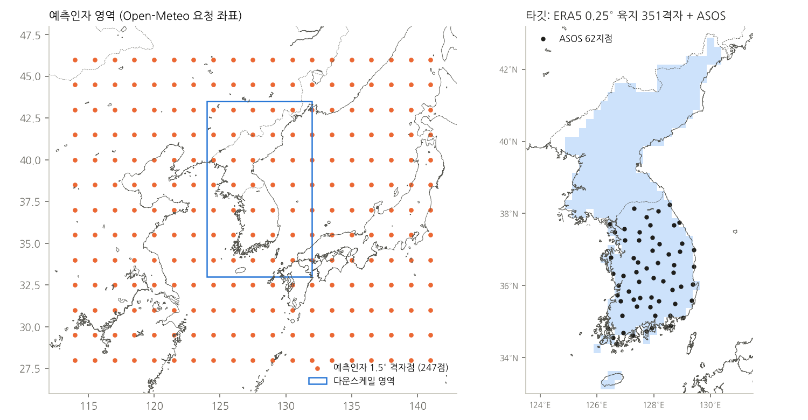
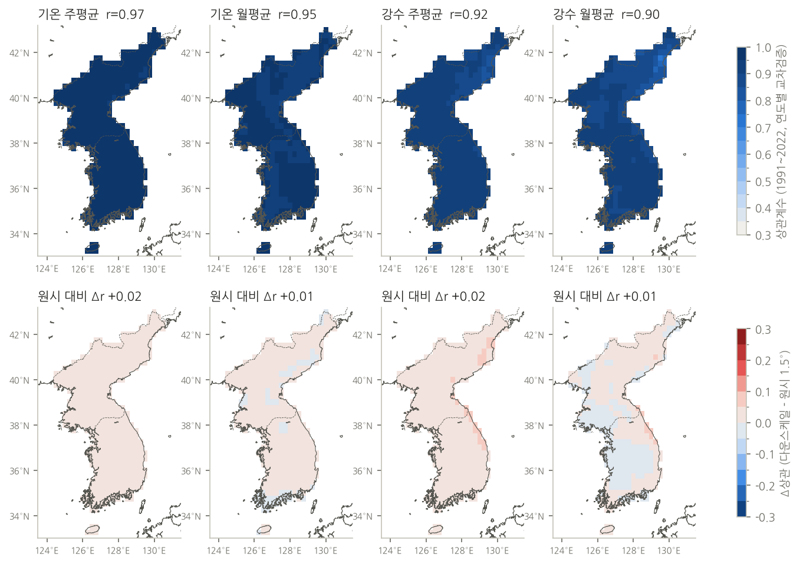
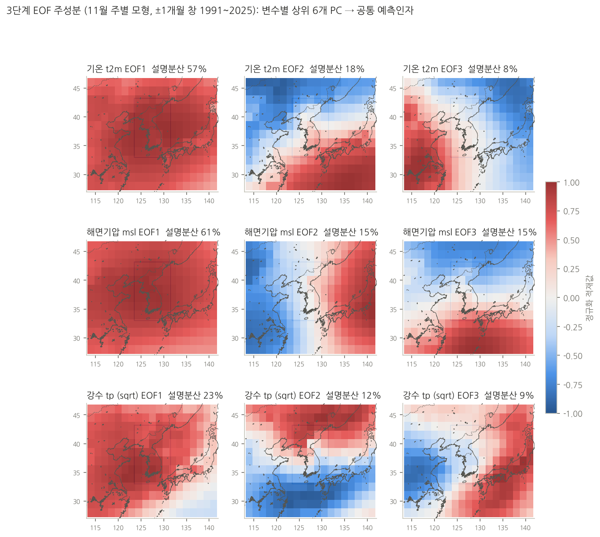
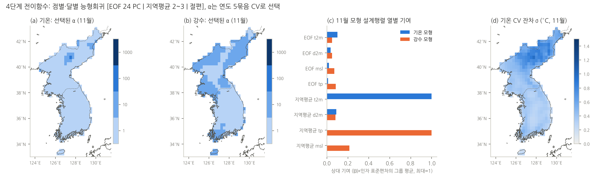

# downscale_by_pyesd — 한반도 기온·강수 상세예측 (PyESD 방식)

[PyESD](https://github.com/Dan-Boat/PyESD)(Boateng & Mutz, Perfect-Prognosis 경험적 통계 다운스케일링)의 절차를
**북한을 포함한 한반도 0.25° 412격자**와 **ASOS 66지점**(내륙 62 + 제주 4; 남한 평균은 제주 제외 62지점)에 적용합니다.
PyPI의 pyESD 1.0.7은 scikit-learn 1.9와 맞지 않아(ARD `n_iter`) 같은 역할의 구성요소를 `pyesd/`에 직접 구현했습니다.

두 체계를 분리해 운영합니다.

| 체계 | 폴더 | 예보 자료 | 예측인자 | 전이함수 | 산출 |
|---|---|---|---|---|---|
| **EC46 주별 1개월(1~4주)** | `ec46_weekly/` | Open-Meteo EC46 51멤버 (지상 4변수만 제공) | ERA5 1.5° 247점 t2m·d2m·msl·tp: 변수별 EOF 6개 + 반경 250 km 평균 | 점별·달별 능형회귀 | 매일 (GitHub Actions) |
| **SEAS5 월별 3개월** | `seas5_monthly/` | C3S CDS SEAS5 51멤버 + 재예보 1993~2016 (지상·상층·SST) | PyESD 원본형: 지역평균 인자(지상 + z500·z850·t850·q850·u/v850) + 장에서 직접 계산한 기후지수(Niño3.4·IOD·WNPSH·EAWM 등) + EOF | 점별 ARD 회귀(자동 인자선택) | 매월 (SEAS5 공개 후) |

EC46은 모델 원자료를 받을 경로가 생기기 전까지 Open-Meteo로만 운영합니다.

## 폴더

```
pyesd/          PyESD 구성요소 재구현: esd.py (기후값·EOF·반경평균·배치 능형회귀), kma_util.py (기상청 API)
ec46_weekly/    EC46 주별 운영: forecast.py, maps.py, openmeteo.py, models/*.npz (학습된 EOF·계수), data/geo
seas5_monthly/  SEAS5 CDS 기반 3개월 체계 (자료 입수 → 예측인자 → 학습·재예보 검증 → 전망)
training/       공통 학습·검증 코드 (ERA5·ASOS 입수, prep, train, 교차검증 그림, 모형 비교, 계수 내보내기)
docs/           검증 그림·표, 단계별 적용 기록 페이지(pyesd_korea.html)
```

## 방법 요약 (공통)

| 단계 | PyESD | 구현 |
|---|---|---|
| 예측대상 | `StationOperator`, `MonthlyStandardizer` | ERA5 0.25° 412격자(남·북한 경계 폴리곤 육지비율 ≥ 20 %) + ASOS 66지점. 1991–2020 조화함수(4항) 일별 기후값 제거, 강수는 sqrt 변환 |
| 예측인자 | `Predictor`, `RegionalAverage` | 대상점별 반경 250 km 가우스 가중평균 |
| 원격상관 | `teleconnections.eof_analysis` | 변수별 표준화 편차장 SVD → 상위 PC |
| 전이함수 | `Regressors`, `fit` | EC46: 능형회귀(열 표준화, α 연도 5묶음 CV). SEAS5: ARD |
| 검증 | `cross_validate_and_predict` | leave-one-year-out(EOF 폴드별 재적합) + 독립 2023–2026. SEAS5는 재예보로 리드별 ACC·RPSS |
| 예측 | `predict`(GCM) | 모형기후 편차 보정 후 학습 EOF·계수에 투영, 멤버 + CV 잔차 σ 정규혼합 → 3분위 확률 |

다운스케일 재현력(재분석 대규모장 입력, 교차검증 상관): 격자 기온 주 0.97·월 0.95, 강수 0.92·0.90; ASOS 기온 0.95·0.90, 강수 0.87·0.81.
전체 표 [docs/tables/skill_summary.csv](docs/tables/skill_summary.csv), 모형 비교 [docs/tables/model_comparison_asos_month.csv](docs/tables/model_comparison_asos_month.csv),
단계별 적용 기록 [docs/pyesd_korea.html](docs/pyesd_korea.html).

| | |
|---|---|
|  |  |
|  |  |

## EC46 주별 운영

```bash
pip install -r requirements.txt
python ec46_weekly/forecast.py --maps                 # Open-Meteo EC46 → out/ec46_weekly/
python ec46_weekly/forecast.py --demo --maps          # 네트워크 없이 합성 자료로 시험
python ec46_weekly/forecast.py --products week,month  # 보조: Open-Meteo SEAS5 월별도 함께
```

산출 `out/ec46_weekly/`: `downscaling.json`(격자·지점 좌표, 기간별 편차·값·3분위 확률·CV 상관, 보정량, `south_mean` = 제주 제외 62지점 평균),
`asos66_downscaled.csv`(`jeju` 열), `map_week.png`.
GitHub Actions 「EC46 주별 상세예측」이 매일 실행해 `out-ec46` 브랜치에 올립니다.

## 재학습 (`training/`)

```bash
pip install -r training/requirements-train.txt
cd training && export KDS_RAW=../data/raw KDS_WORK=../data/work OMP_NUM_THREADS=1
CDSAPI_KEY=... python get_era5_kor.py $KDS_RAW   # 한반도 0.25° 타깃 (ECMWF ARCO geoChunked)
CDSAPI_KEY=... python get_era5_pred.py $KDS_RAW  # 1.5° 예측인자
KMA_AUTHKEY=... python get_asos.py $KDS_RAW/asos ; KMA_AUTHKEY=... python get_asos_jeju.py $KDS_RAW/asos_jeju
python prep.py && python train.py grid T week    # (grid|asos) (T|P) (week|month)
python make_figs.py && python make_steps.py && python export_models.py ../ec46_weekly/models
```

인증키(CDS, 기상청 API허브)는 환경변수로만 넘기고 파일·저장소에 저장하지 않습니다. 최종 모형 학습기간 1991–2025, 평년 1991–2020.
