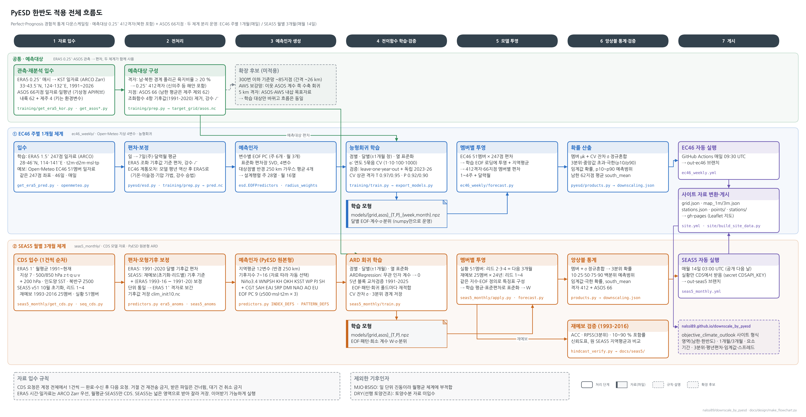

# PyESD 한반도 적용 설계도

이 저장소에 구현된 두 체계(EC46 주별 1개월, SEAS5 월별 3개월)의 흐름을 단계별로 그린 설계도입니다.
상자마다 입력·출력 자료, 해상도, 담당 코드 모듈을 적었습니다. 그림은 `make_flowchart.py`(matplotlib)로 다시 만듭니다.

```bash
pip install matplotlib koreanize-matplotlib
python docs/design/make_flowchart.py      # docs/design/flow_*.png, flow_*.svg
```

| 그림 | 내용 |
|---|---|
| [flow_overview](flow_overview.png) | 전체 흐름도: 공통 예측대상 + EC46·SEAS5 두 레인 × 7단계 |
| [flow_s1_data](flow_s1_data.png) | 1 자료 입수: ARCO Zarr · 기상청 API허브 · Open-Meteo · CDS 1건 순차 판단 흐름 |
| [flow_s2_prep](flow_s2_prep.png) | 2 전처리: 육지 마스크, 집계·변환·조화 기후값, EC46 계통오차, SEAS5 모형기후 보정 |
| [flow_s3_predictors](flow_s3_predictors.png) | 3 예측인자: EOF PC, 반경 250 km 지역평균, 기후지수(상자·점·EOF 패턴), 특징표 |
| [flow_s4_train](flow_s4_train.png) | 4 전이함수 학습·검증: 능형회귀(EC46) · ARD(SEAS5), 폴드별 재적합 교차검증 |
| [flow_s5_project](flow_s5_project.png) | 5 모델 투영: 멤버별 투영, 역변환 |
| [flow_s6_stats](flow_s6_stats.png) | 6 앙상블 통계·검증: 정규혼합 확률·백분위, 재예보 ACC·RPSS·포함률·신뢰도 |
| [flow_s7_publish](flow_s7_publish.png) | 7 자동 실행·게시: Actions → 결과 브랜치 → site.yml → gh-pages |



`flowlib.py`는 상자(처리·자료·판단·설명)와 직교 화살표를 그리는 작은 도구입니다. 좌표는 인치 단위이고 상자 높이는 글줄 수로 정해집니다.
